<!-- ═══════════════ HEADER ═══════════════ -->
<div align="center">
  
</div>

<div align="center">
  <a href="https://git.io/typing-svg">
    
  </a>
</div>

<br/>

<div align="center">
  
  
  
</div>

<br/>

<!-- ═══════════════ ABOUT ═══════════════ -->
## 👨‍💻 About Me

```js
const hafizh = {
  name: "Muhammad Hafizh Naufal",
  role: "Full Stack Developer",
  location: "Indonesia 🇮🇩",
  focus: ["Web Apps", "REST APIs", "Clean UI/UX"],
  currentlyLearning: ["System Design", "C#", "Better Architecture"],
  funFact: "I debug with console.log and I'm not ashamed 😎",
};
```

<!-- ═══════════════ TECH STACK ═══════════════ -->
## 🛠️ Tech Stack

<div align="center">
  
  <br/>
  
  <br/>
  
</div>

<!-- ═══════════════ STATS ═══════════════ -->
## 📊 GitHub Stats

<div align="center">
  
  
</div>

<div align="center">
  
</div>

<!-- ═══════════════ ACTIVITY ═══════════════ -->
## 📈 Contribution Activity

<div align="center">
  
</div>

<br/>

<!-- ═══════════════ PACMAN ═══════════════ -->
<picture>
  <source media="(prefers-color-scheme: dark)" srcset="https://raw.githubusercontent.com/Muhammad-Hafizh-Naufal/Muhammad-Hafizh-Naufal/output/pacman-contribution-graph-dark.svg">
  <source media="(prefers-color-scheme: light)" srcset="https://raw.githubusercontent.com/Muhammad-Hafizh-Naufal/Muhammad-Hafizh-Naufal/output/pacman-contribution-graph.svg">
  
</picture>

<!-- ═══════════════ CONNECT ═══════════════ -->
## 🤝 Let's Connect

<div align="center">
  <a href="https://www.instagram.com/hafizh_naufal03/" target="_blank">
    
  </a>
  <a href="https://www.linkedin.com/in/muhammad-hafizh-naufal-3926162b5/" target="_blank">
    
  </a>
  <a href="https://github.com/Muhammad-Hafizh-Naufal" target="_blank">
    
  </a>
</div>

<br/>

<div align="center">
  <i>"Talk is cheap. Show me the code."</i> — Linus Torvalds
</div>

<!-- ═══════════════ FOOTER ═══════════════ -->

